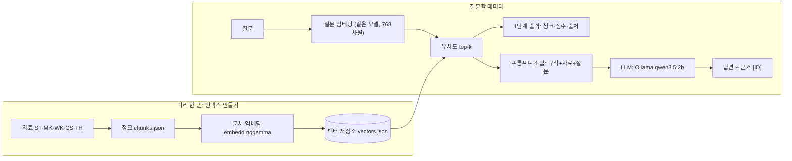

# IP 기획 가이드 챗봇 PRD

작성일 2026-10-14

## 개요


**배경.** 만드는 사람은 애니메이션·게임·VFX 제작 경험이 있는 애니메이션 슈퍼바이저이고, 오리지널 IP 제작이 목표입니다. 아직 만든 IP가 없어서, 먼저 "IP를 어떻게 만들고 키우는가"에 대한 자료를 모아 두고 꺼내 쓸 도구가 필요합니다.

**문제.**

- 자료가 흩어져 있습니다. 스튜디오 강의, 산업 백서, 기사, 위키 문서를 매번 따로 찾아야 합니다.
- 일반 LLM은 사례를 지어냅니다. 특히 국내 소형 캐릭터 IP의 연도·매출·확장 순서는 그럴듯하게 틀리기 쉽습니다.
- 답의 근거를 원문까지 되짚을 수 없습니다.

## 사용자와 사용 시나리오

주 사용자는 IP 기획을 준비하는 나 자신입니다. 부 사용자는 나중에 합류할 작가·디자이너·게임 기획자입니다.

| 상황 | 질문 예 | 기대하는 답의 근거 |
| --- | --- | --- |
| 캐릭터 구상 | 픽사는 주인공의 결점을 어떻게 설계해? | 스튜디오 기법(ST) 청크 |
| 서사 구조 | 영웅의 여정은 어떤 단계로 나뉘어? | 스토리텔링 이론(TH) 청크 |
| 매체 확장 | 이모티콘에서 시작해 굿즈·애니로 확장한 사례는? | 국내 사례(CS) + 확장 전략(MK) 청크 |
| 세계관 확장 | MCU는 여러 작품을 어떻게 하나의 세계로 묶었어? | 확장 전략(MK) 청크 |
| 자료 밖 질문 | 내 캐릭터 아이디어가 성공할까? | 근거 없음 → "자료에 없음"으로 안내 |

## 목표, 비목표, 수용 기준

**목표**

1. **자료 찾기:** 흩어진 스토리텔링·IP 자료를 질문 하나로 찾고, 원문 링크를 바로 확인할 수 있다.
2. **근거 있는 답:** 답변 문장마다 근거 ID가 붙어, 지어낸 내용인지 가려낼 수 있다.
3. **정직한 거절:** 자료에 없는 질문에는 지어낸 답 대신 "자료에 없음"을 받는다.

**비목표**

- 웹 화면, 서버, 배포, 로그인
- 아이디어 생성, 작품 평가, 성공 예측 (방법론과 사례 안내만 한다)
- 이미지·영상 자료 분석 (텍스트 자료만)
- 최신 매출·팔로워 수치 갱신 (자료의 기준일까지만 답한다)
- 책·논문·기사 원문 저장이나 재배포 (원문은 라이선스가 허용하는 자료만)

**수용 기준** (아래가 모두 보이면 합격)

- [ ] `search.mjs "영웅의 여정은 어떤 단계야?"` → top-3 안에 TH 청크가 있고, 결과마다 점수와 url이 보인다.
- [ ] `ask.mjs "무직타이거는 어떤 방식으로 성장했어?"` → 답변 문장마다 `[CS-…]`가 붙고, 답변 끝에 `📚 근거` 목록(id·url·확인일)이 보인다.
- [ ] 자료에 없는 내용을 물으면 답변에 "확인 불가"라는 문구가 보이고, 숫자·연도가 새로 나오지 않는다.
- [ ] "내일 날씨 알려 줘", "내 캐릭터가 성공할까?" → LLM 답변 없이 "관련 자료가 약함" 또는 "자료에 없음"과 1위 점수가 보인다.
- [ ] `copyright-blocked`로 표시한 자료를 물으면 "저작권 침해 요소가 있어 내용 확인 불가"와 출처만 보이고, 내용은 보이지 않는다.
- [ ] Ollama가 꺼져 있으면 "Ollama에 연결할 수 없습니다. `ollama serve` 실행 후 다시 시도하세요" 안내가 보이고, 오류 스택 없이 끝난다.
- [ ] 임베딩 모델이나 설정이 `vectors.json`과 다르면 "인덱스를 다시 만드세요(`node src/build-index.mjs`)" 안내가 보이고 검색하지 않는다.
- [ ] `build-index.mjs` 실행 결과에 "license·url 누락 0건"과, 언론사·발행일이 없어 건너뛴 기사 목록이 보인다.
- [ ] 같은 질문을 `--no-rag`로 물으면 `📚 근거` 목록이 없는 답이 나오고, `README.md` 비교표에 두 답의 환각 문장 수가 나란히 적혀 있다.
- [ ] 평가 질문 20개를 돌리면 "Hit@3: 13/16 이상"이 출력된다.

## 지식 베이스(코퍼스) 설계

**청크는 네 갈래(A\~D) 자료로 만듭니다.** 원문을 넣는 것은 라이선스가 허용하는 자료뿐이고, 논문 초록·기사는 원문 없이 출처에 적힌 사실만 정리해 넣습니다(원문 미수록). 내 작업 기준, 개인 생각, Claude의 추측·예측·해석은 넣지 않습니다.

| 갈래 | 담는 내용 | 원문을 넣는 출처 | 원문 없이 정리만 넣는 출처 | 목표 청크 수 | id |
| --- | --- | --- | --- | --- | --- |
| A. 스튜디오 제작 기법 | 디즈니 12원칙, 스토리보드, 모델 시트 | 위키백과: [애니메이션의 12가지 기본 원칙](https://ko.wikipedia.org/wiki/%EC%95%A0%EB%8B%88%EB%A9%94%EC%9D%B4%EC%85%98%EC%9D%98_12%EA%B0%80%EC%A7%80_%EA%B8%B0%EB%B3%B8_%EC%9B%90%EC%B9%99), [스토리보드](https://ko.wikipedia.org/wiki/%EC%8A%A4%ED%86%A0%EB%A6%AC%EB%B3%B4%EB%93%9C), [Model sheet](https://en.wikipedia.org/wiki/Model_sheet), [Disney Animation: The Illusion of Life](https://en.wikipedia.org/wiki/Disney_Animation:_The_Illusion_of_Life) | — | 15\~25 | ST- |
| B. IP 확장·마케팅 전략 | OSMU, 미디어 믹스, 트랜스미디어, 디즈니 프랜차이즈, MCU, 지브리, 픽사 | 위키백과: [원 소스 멀티 유즈](https://ko.wikipedia.org/wiki/%EC%9B%90_%EC%86%8C%EC%8A%A4_%EB%A9%80%ED%8B%B0_%EC%9C%A0%EC%A6%88), [미디어 믹스](https://ko.wikipedia.org/wiki/%EB%AF%B8%EB%94%94%EC%96%B4_%EB%AF%B9%EC%8A%A4), [미디어 프랜차이즈](https://ko.wikipedia.org/wiki/%EB%AF%B8%EB%94%94%EC%96%B4_%ED%94%84%EB%9E%9C%EC%B0%A8%EC%9D%B4%EC%A6%88), [트랜스미디어 스토리텔링](https://ko.wikipedia.org/wiki/%ED%8A%B8%EB%9E%9C%EC%8A%A4%EB%AF%B8%EB%94%94%EC%96%B4_%EC%8A%A4%ED%86%A0%EB%A6%AC%ED%85%94%EB%A7%81), [마블 시네마틱 유니버스](https://ko.wikipedia.org/wiki/%EB%A7%88%EB%B8%94_%EC%8B%9C%EB%84%A4%EB%A7%88%ED%8B%B1_%EC%9C%A0%EB%8B%88%EB%B2%84%EC%8A%A4), [스튜디오 지브리](https://ko.wikipedia.org/wiki/%EC%8A%A4%ED%8A%9C%EB%94%94%EC%98%A4_%EC%A7%80%EB%B8%8C%EB%A6%AC), [픽사](https://ko.wikipedia.org/wiki/%ED%94%BD%EC%82%AC) | 《2025 캐릭터산업백서》 한국어 본문 (공공누리 제4유형: 출처표시·상업적 이용금지·변경금지. 외부 배포·상업적 재사용·변형 전에 이용 근거 확인) | 20\~30 | MK- |
| C. 국내 캐릭터 IP 사례 | 스티키몬스터랩, 조구만, 무직타이거, 최고심, 망그러진 곰, 카카오프렌즈, 라인프렌즈 (서로 다른 성장 방식 비교) | 위키백과: [카카오프렌즈](https://ko.wikipedia.org/wiki/%EC%B9%B4%EC%B9%B4%EC%98%A4%ED%94%84%EB%A0%8C%EC%A6%88), [IPX(라인프렌즈)](<https://ko.wikipedia.org/wiki/IPX_(%EA%B8%B0%EC%97%85)>). 나머지 다섯 곳은 한국어 위키백과 문서 없음 | 공식 발표·원자료 우선, KCI 논문(최고심 등), 언론사·URL·발행일이 있는 기사. 같은 원자료에서 나온 기사들은 근거 묶음 하나로 | 20\~30 | CS- |
| D. 스토리텔링 이론 | 플롯·서사 구조, 3막 구조·기승전결, 영웅의 여정, 캐릭터 아크, 극적 장치 | 위키백과(한): 플롯, 서사학, 인물호, 맥거핀, 클리셰, 민담 형태론, 영웅의 여정, 천의 얼굴을 가진 영웅, 시학(아리스토텔레스) · 위키백과(영): Story structure, Three-act structure, Kishōtenketsu, Character arc, Chekhov's gun, Hero's journey, The Thirty-Six Dramatic Situations, Save the Cat!, The Writer's Journey · 퍼블릭 도메인: [『The Poetics of Aristotle』](https://www.gutenberg.org/ebooks/1974) (구텐베르크) | — | 25\~35 | TH- |

**KCI 논문 초록 정리 목록** ("캐릭터 IP 스토리텔링" 검색 6편 중)

| 논문 | 저자 | 학술지 (권호, 쪽) | 발행 |
| --- | --- | --- | --- |
| [스토리텔링을 활용한 인스타그램 캐릭터의 활성화 전략 연구: 〈최고심〉을 중심으로](https://www.kci.go.kr/kciportal/ci/sereArticleSearch/ciSereArtiView.kci?sereArticleSearchBean.artiId=ART003094385) | 변예인, 박기수 | 애니메이션연구 20(2), pp.118\~154 (한국애니메이션학회) | 2024.06 |
| [SNS웹툰 IP와 캐릭터 융합사례 연구: 스토리텔링의 정서적 공감 요인을 중심으로](https://www.kci.go.kr/kciportal/ci/sereArticleSearch/ciSereArtiView.kci?sereArticleSearchBean.artiId=ART003131097) | 류유희 | 차세대컨버전스정보서비스기술논문지 13(5), pp.649\~658 (차세대컨버전스정보서비스학회) | 2024.10 |
| [지역 콘텐츠IP를 활용한 로컬 브랜딩 성공 요인 도출: 애니메이션 〈엄마 까투리〉 개발사례를 중심으로](https://www.kci.go.kr/kciportal/ci/sereArticleSearch/ciSereArtiView.kci?sereArticleSearchBean.artiId=ART002981409) | 성종현 | 인문콘텐츠 (69), pp.137\~161 (인문콘텐츠학회) | 2023.06 |
| [캐릭터–스포츠 협업 사례의 스토리텔링 전략 연구](https://www.kci.go.kr/kciportal/ci/sereArticleSearch/ciSereArtiView.kci?sereArticleSearchBean.artiId=ART003310557) | 김지영, 이준섭 | 한국콘텐츠학회 논문지 26(2), pp.651\~659 (한국콘텐츠학회) | 2026.02 |

서지 정보는 KCI 검색 결과에서 확인했습니다(2026-10-14). 초록·본문은 STEP 2에서 읽고 `review`를 표시합니다.

**책 5권을 다룬 위키백과 청크 (21개, `wiki-storytelling-chunks.json`).** 출처는 책이 아니라 아래 영문 위키백과 문서입니다(2026-10-14 확인). `source_type: wikipedia`, `license: CC BY-SA`이며, 책 본문은 직접 요약하지 않습니다.

| 위키백과 문서 | 관련 책 | 청크 | 담은 내용 |
| --- | --- | --- | --- |
| [Hero's journey](https://en.wikipedia.org/wiki/Hero%27s_journey) | 『천의 얼굴을 가진 영웅』 | TH-101\~104 | 단일 신화, 출발·입문·귀환 17단계 (입문·귀환은 단계 이름만) |
| [The Writer's Journey](https://en.wikipedia.org/wiki/The_Writer%27s_Journey:_Mythic_Structure_for_Writers) | 『The Writer's Journey』 | TH-111\~114 | 인물 원형 8가지, 영웅의 여정 12단계 |
| [Save the Cat!](https://en.wikipedia.org/wiki/Save_the_Cat!:_The_Last_Book_on_Screenwriting_You%27ll_Ever_Need) | 『Save the Cat!』 | TH-121\~127 | 로그라인 4조건, 이야기 유형 10가지, 비트 시트 15비트, 고양이 구하기 규칙, 비판 |
| [Disney Animation: The Illusion of Life](https://en.wikipedia.org/wiki/Disney_Animation:_The_Illusion_of_Life), [Twelve basic principles of animation](https://en.wikipedia.org/wiki/Twelve_basic_principles_of_animation) | 『The Illusion of Life』 | ST-101\~104 | 책 개요, 애니메이션 12원칙 |
| [Creativity, Inc.](https://en.wikipedia.org/wiki/Creativity,_Inc.), [Pixar](https://en.wikipedia.org/wiki/Pixar) | 『Creativity, Inc.』 | ST-111\~112 | 책 개요, 픽사 브레인트러스트 |

**저작권 기준.** 자료는 네 묶음으로 나눕니다.

| 묶음 | 해당 자료 | 청크에 넣는 방식 |
| --- | --- | --- |
| 원문 사용 가능 | 위키백과(CC BY-SA), 퍼블릭 도메인(시학) | 요약 또는 원문 발췌, 출처·라이선스 표기 |
| 조건부 원문 | 《2025 캐릭터산업백서》(공공누리 제4유형) | 내 PC 학습용으로만 사용, 조건을 청크에 기록. 외부 배포·상업적 재사용·변형 전 이용 근거 확인 |
| 원문 미수록 (`link-only`) | 논문 초록, 회사 공식 발표, 기사(언론사·URL·발행일이 모두 있는 것만) | 원문 문장을 옮기지 않고 출처에 적힌 사실만 정리, 해석·추측을 보태지 않음, 서지 정보와 위치 기록 |
| 제외 | 책 본문(위키백과 문서로 대신), 내 작업 기준·개인 생각, 나무위키, 출처나 발행일이 없는 기사, 저작권 만료가 불확실한 옛 책 | 넣지 않음 |

나무위키는 CC BY-NC-SA(비영리 조건)라, 나중에 IP 사업에 쓸 자료와 섞이면 문제가 될 수 있어 뺍니다. 구텐베르크의 1910년대 작법서(『Writing the Photoplay』 등)는 미국 기준 퍼블릭 도메인이지만 한국 기준 저작권 만료를 확인하지 못해 뺍니다. 법률 자문이 아니라 안전하게 잡은 기준입니다.

**청크 형식.** `data/chunks.json`의 각 항목은 기본 필드 `{ id, text, url, section }`에 아래 필드를 더합니다. 결정 사항 3\~6번을 데이터로 남기기 위한 필드입니다.

- `category`: ST / MK / WK / CS / TH. 검색 필터와 관찰 실습에 씁니다.
- `source_type`: wikipedia / public-domain / gov-open / official / article / paper-abstract(논문 초록 정리).
- `license`: CC BY-SA / PD / KOGL-4 / link-only(원문 미수록, 출처 링크만). KOGL-4는 이용 조건을 `license_note`에 적습니다.
- `claim_type`: fact(확인된 사실) / unverifiable(확인 불가) / copyright-blocked(저작권 침해 요소로 내용 미수록).
- `published_at`, `checked_at`: 발행일과 확인일. 기사는 publisher(언론사)도 필수.
- `location`: 페이지 또는 문서 안 위치.
- `data_year`: 조사·통계 기준 연도 (수치가 있을 때).
- `evidence_group`: 같은 원자료에서 나온 근거를 묶는 이름. 묶음 하나는 근거 하나로 셈니다.
- `review`: 논문 초록 정리만. abstract-only(초록만) / full-text(본문 검토 완료).

**청크 규칙.**

1. 한 청크에 주장 하나, 최소 120자, 혼자 읽어도 뜻이 통해야 한다.
2. 출처에 적힌 사실만 넣는다. 원문에 없는 해석·추측·예측을 보태지 않는다.
3. 출처가 주장을 직접 뒷받침하지 않으면 fact로 적지 않는다. 협업 발표만 있는 매출·수익성·성공 원인은 청크로 만들지 않는다.
4. 자료가 없으면 `unverifiable`(확인 불가)로 적고, 추정값을 채우지 않는다.
5. 원문을 넣을 수 있는 것은 `license`가 CC BY-SA·PD인 자료와, 조건을 기록한 KOGL-4 백서뿐이다. 나머지는 원문 문장을 옮기지 않고 출처에 적힌 사실만 정리해(`license: link-only`) 넣고, 출처(url·발행일·위치)를 반드시 붙인다.
6. 영어 자료는 한국어로 요약하고 url은 영어 원문으로 둔다. 한국어 질문과 영어 청크는 점수가 낮게 나올 수 있기 때문이다.

기사 청크(`source_type: article`)는 `publisher`(언론사), `url`, `published_at`이 모두 있어야 하며, 하나라도 비면 인덱스를 만들 때 건너뛴니다(`build-index.mjs`가 건너뛴 청크 목록을 출력).

저작권에 민감하거나 침해 소지가 있는 자료는 `claim_type: copyright-blocked` 청크로만 남깁니다. 이 청크의 text에는 자료 제목과 주제만 적고 내용은 넣지 않으며, 120자 규칙의 예외입니다. 검색 1위가 이 청크면 LLM을 부르지 않고 "저작권 침해 요소가 있어 내용 확인 불가"와 출처를 출력합니다.

**출처 점검 결과 (2026-10-14 확인).** 위 표의 위키백과 문서는 모두 존재합니다. 한국어판에 "캐릭터 상품화", "3막 구조", "체호프의 총", "프라이타크의 피라미드"는 없어서 영문판을 씁니다. 한국어 "영웅의 여정", "원 소스 멀티 유즈", "기승전결", "복선"은 분량이 짧아 영문판으로 보충합니다.

## 기능 요구사항

필수 7개는 카테고리 필터와 기준일 표시 2개를 더합니다.

| ID | 기능 | 단계 | 파일 | 우선순위 |
| --- | --- | --- | --- | --- |
| F1 | 청크를 벡터로 바꿔 `data/vectors.json`에 저장 | 1 | `build-index.mjs` | 필수 |
| F2 | 질문 → top-k(기본 3, `--k`로 변경) 청크를 id·section·category·점수·url과 함께 출력 | 1 | `search.mjs` | 필수 |
| F3 | 1위 점수가 기준보다 낮으면 "관련 자료가 약함" 경고 | 1 | `search.mjs` | 필수 |
| F4 | `--category ST/MK/WK/CS/TH`로 검색 범위 제한 | 1 | `search.mjs` | 선택 |
| F5 | 규칙 + 자료 + 질문으로 프롬프트 조립. 규칙: 자료 안에서만 답하기, 문장마다 `[ID]`, 없으면 "자료에 없음", 수치·연도는 자료 그대로, 자료가 직접 뒷받침하지 않는 매출·성공 원인은 단정하지 않고 "확인 불가" | 2 | `prompt.mjs` | 필수 |
| F6 | Ollama로 답변을 스트리밍하고, 끝에 근거 목록(id·url) 출력 | 2 | `ollama.mjs`, `ask.mjs` | 필수 |
| F7 | 약한 근거면 LLM을 부르기 전에 안내하고 멈춤. 1위 청크가 copyright-blocked이면 "저작권 침해 요소가 있어 내용 확인 불가"와 출처를 출력하고 멈춤 | 2 | `ask.mjs` | 필수 |
| F8 | `--no-rag`로 자료 없이 같은 질문을 물어 비교 | 2 | `ask.mjs` | 필수 |
| F9 | 근거 목록에 `source_type`, `claim_type`, `checked_at`, `location`을 함께 표시 | 2 | `ask.mjs` | 선택 |

## 기술 환경과 설계 계약

**기술 구성은 기본 구성입니다.** 바뀌는 것은 자료와 청크 필드뿐이라, 같은 순서로 진행할 수 있습니다.



문서와 질문은 반드시 같은 임베딩 모델·설정으로 바꿉니다. 1위 점수가 기준보다 낮으면 2단계로 넘어가지 않습니다.

| 항목 | 결정 |
| --- | --- |
| 실행 | 내 PC, PowerShell, Node.js v20 이상 (`node src/파일.mjs`) |
| 임베딩 | transformers.js + `onnx-community/embeddinggemma-300m-ONNX`, dtype q8, 768차원, mean pooling + 정규화 |
| 입력 형식 | 문서 `title: 섹션명 \| text: 본문`, 질문 `task: search result \| query: 질문` |
| 벡터 저장소 | `data/vectors.json`, 전체 비교(내적 = 코사인 유사도) |
| LLM | Ollama `qwen3.5:2b` (2단계에서만) |
| 코드 작성 | Claude Code에게 지시 (바이브 코딩) |

**CLAUDE.md에 넣을 계약**

- 임베딩은 `src/embedder.mjs` 한 곳에서만 정의한다. 모델이나 설정이 바뀌면 검색을 거부하고 인덱스를 다시 만든다.
- 청크 id는 한 번 붙이면 뜻을 바꾸지 않는다.
- 모르는 사실과 URL은 지어내지 않는다. 열어 보지 못한 출처는 `[검증 필요]`로 표시한다.
- 요청한 파일만 고치고, 실행 결과와 함께 보고한다.

**폴더 구조**

```
ip-guide-rag/
├─ CLAUDE.md
├─ data/chunks.json, data/vectors.json
├─ eval/questions.json
├─ src/embedder.mjs, build-index.mjs, search.mjs
├─ src/prompt.mjs, ollama.mjs, ask.mjs
└─ README.md
```

## 평가 계획

**질문 20개로 검색과 답변을 각각 잽니다.** 갈래별(ST·MK·CS·TH) 4개씩 16개, 자료 밖 질문 4개입니다. 질문마다 정답 청크 id를 미리 적어 둡니다(`eval/questions.json`).

| 지표 | 정의 | 목표(제안) |
| --- | --- | --- |
| 검색 적중률 (Hit@3) | 정답 청크가 top-3 안에 든 질문 비율 | 16개 중 13개 이상 |
| 근거 표기율 | 답변 문장 중 `[ID]`가 붙은 비율 | 90% 이상 |
| 환각 건수 | 자료에 없는 수치·연도·사실이 나온 문장 수 (RAG 있음 vs 없음) | RAG 있을 때가 뚜렷이 적음 |
| 자료 밖 질문 처리 | "자료에 없음" 또는 약한 근거 안내로 답한 비율 | 4개 중 3개 이상 |

**관찰 실습(STEP 5)에서 볼 것.** 같은 주제를 다룬 청크가 top-3를 독차지하는지, 고유명사("무직타이거") 질문에서 뜻 검색이 약한지 확인합니다. 약하면 BM25 하이브리드를 선택 심화로 시도합니다.

**비교 실험(STEP 8) 예시 질문.** "조구만 스튜디오는 어떤 채널에서 먼저 팬을 모았어?" RAG 없이는 연도·채널을 지어낼 가능성이 크고, RAG가 있으면 CS 청크 범위 안에서만 답해야 합니다.

## 리스크, 진행 순서, 결정 사항

**리스크**

| 리스크 | 영향 | 대응 |
| --- | --- | --- |
| 자료 수집·대조에 시간이 많이 듦 | 일정 지연 | 첫 버전은 120개로 제한, CS는 사례 5곳부터 |
| 공식 발표·논문·기사 요약의 수치가 틀림 | 근거 있는 환각 | 수치는 두 출처 교차, 아니면 `[검증 필요]` |
| 책·논문·기사 원문 저작권 | 재배포 문제 | 라이선스 허용 자료만 원문 사용, 나머지는 원문 없이 출처에 적힌 사실만 정리, 나무위키·출처 없는 기사 제외 |
| 비슷한 청크가 top-3를 독차지 | 다른 갈래 자료가 묻힘 | `category` 필터(F4), 중복 청크 정리 |
| 2B 모델이 자료 밖으로 답함 | 규칙 위반 | 시스템 메시지 강화, 약한 근거면 LLM 호출 안 함(F7) |

**진행 순서 **

1. STEP 0\~1: 환경 준비, `CLAUDE.md` 첫 버전 (이 PRD의 개요·목표·비목표가 재료)
2. STEP 2: 자료 수집, `data/chunks.json`
3. STEP 3: 임베딩, `data/vectors.json`
4. STEP 4: 검색기 `search.mjs`
5. STEP 5: 관찰 실습, 기준 점수 조정
6. STEP 6\~7: 프롬프트 조립과 Ollama 답변
7. STEP 8: RAG 유무 비교, 평가 질문 20개 실행
8. STEP 9: `README.md`에 실행 방법과 관찰 기록 정리

**결정 사항: 자료 선정과 근거 판단 기준** (2026-10-14 결정)

1. 국내 초기 사례는 스티키몬스터랩, 조구만, 무직타이거, 최고심, 망그러진 곰, 카카오프렌즈, 라인프렌즈로 한다. 인기 순위보다 서로 다른 성장 방식의 비교를 목적으로 선정한다.
2. 공식 발표·원자료를 우선 확인하되, 출처의 권위와 해당 주장을 실제로 뒷받침하는 정도를 구분한다. 협업 발표만으로 매출·수익성·성공 원인을 단정하지 않는다.
3. 각 주장에 출처 URL, 발행일, 확인일, 해당 페이지 또는 위치, 조사·통계 기준 연도를 기록한다. 확인된 사실만 기록한다.
4. 동일 원자료에서 파생된 기사들은 하나의 근거 묶음으로 취급한다. 자료가 없으면 "확인 불가"로 기록하며 추정값을 사실처럼 채우지 않는다.
5. 논문 초록 정리에는 초록에 적힌 주장·연구 방법·한계만 담고 해석을 보태지 않는다. 초록만 확인한 자료는 본문 검토 완료로 표시하지 않는다.
6. 산업 기준 자료는 《2025 캐릭터산업백서》 한국어 본문을 사용한다. 공공누리 제4유형 조건을 기록하고, 외부 배포·상업적 재사용·변형 전에 해당 이용 근거를 확인한다.
7. 약한 근거 판정의 임계값은 0.55를 임시 출발값으로 둔다. 점수 정의와 STEP 5의 측정 결과를 확인한 뒤 최종값 및 변경 이유를 기록한다.
8. 기사도 근거로 포함한다. 단, 언론사·URL·발행일을 반드시 기록하고, 출처나 날짜가 없는 기사는 배제한다. 기사 원문은 옮기지 않고 기사에 적힌 사실만 정리한다.
9. 원문을 넣을 수 없는 자료는 원문 없이 출처에 적힌 사실만 정리하고(원문 미수록), 모든 답변에 출처를 제공한다. 저작권에 민감하거나 침해 소지가 있다고 판단되는 자료는 내용을 수록하지 않고, 그 내용을 물으면 "저작권 침해 요소가 있어 내용 확인 불가"로 답한다.
10. 책은 직접 요약하지 않고, 그 책을 다룬 위키백과 문서로 대신한다 (2026-10-15 변경).
11. KCI 논문 4편(최고심, SNS웹툰 IP, 엄마 까투리, 캐릭터–스포츠 협업)을 논문 초록 정리 목록에 넣는다. 초록만 확인한 논문은 `review: abstract-only`로 표시하고, 논문명·저자·학술지·발행 연도·KCI URL을 출처로 기록한다.
12. 내 작업 기준(`docs/ip-sop.md`, IP-001~003), 내 개인 생각, Claude의 추측·예측·해석은 RAG에 넣지 않는다 (2026-10-15).

남은 결정은 없습니다. 임계값(결정 7번)은 STEP 5 측정 뒤 0.58로 확정했습니다(CLAUDE.md 검색 계약).
