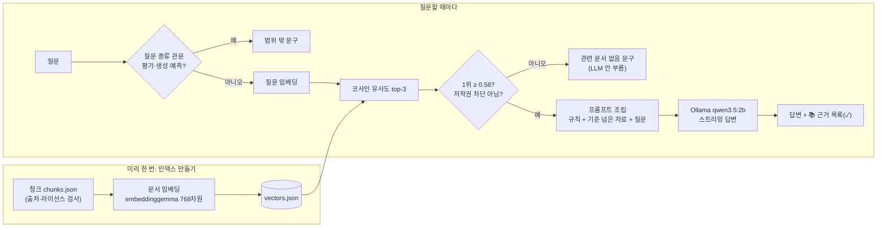

# IP 기획 가이드 챗봇 (로컬 RAG)

IP 기획을 처음 하는 애니메이터가 스토리텔링 이론, 스튜디오 제작 기법, IP 확장 전략, 국내 캐릭터 사례를 물으면 **출처가 확인된 자료만 근거로** 답하는 터미널 챗봇입니다. 모든 처리는 내 Mac에서 돌아갑니다(서버·배포 없음).

## 1. 소개: 무엇을 답하고 무엇을 답하지 않나

**답하는 것**: 자료(청크 133개)에 적힌 내용. 답변 뒤에 근거로 넘긴 자료의 id·출처 url·확인일을 보여 줍니다.

- 스토리텔링 이론: 영웅의 여정, 3막 구조, 세이브 더 캣 비트 시트, 체호프의 총, 아리스토텔레스 『시학』 등
- 스튜디오 제작 기법과 작품: 디즈니 12원칙, 스토리보드, 모델 시트, 픽사 브레인트러스트, 지브리·픽사 작품
- IP 확장 전략: IP(지식재산권)의 뜻, OSMU, 미디어 믹스, 트랜스미디어, 미디어 프랜차이즈, MCU
- 국내 캐릭터 사례: 카카오프렌즈, 라인프렌즈, 최고심, 망그러진 곰, 엄마 까투리, 무직타이거, 조구만 스튜디오

**답하지 않는 것**: 정해진 문장으로 짧게 거절합니다.

| 상황 | 답 |
| --- | --- |
| 자료와 관련 없는 질문 (날씨 등) | 질문과 관련된 문서와 출처를 찾지 못해 답변드리기 어렵습니다. |
| 작품 평가·아이디어 생성·성공 예측 | 작품 평가·아이디어 생성·성공 예측은 근거 문서와 출처로 판단할 수 없어 답변드리기 어렵습니다. |
| 저작권 때문에 내용을 넣지 않은 자료 | 저작권 침해 요소가 있어 해당 내용은 제공하지 않습니다. 출처만 안내드립니다. |
| 답 중 자료에 없는 부분 (매출 수치 등) | 이 부분은 관련 문서와 출처를 찾지 못했습니다. |

최신 매출·팔로워 수치, 이미지·영상 분석, 웹 화면은 만들지 않습니다(PRD 비목표).

## 2. 동작 원리



1. **청크와 인덱스**: 자료를 주장 하나씩 담은 조각(청크)으로 나누고, 같은 임베딩 모델로 768차원 벡터를 만들어 `vectors.json`에 저장합니다.
2. **1단계 검색**: 질문도 같은 모델로 벡터로 바꾸고, 정규화된 벡터의 내적(=코사인 유사도)으로 가장 가까운 청크 3개를 찾습니다.
3. **관문 두 개**: 평가·생성·예측 질문은 검색 전에 문장 패턴으로 거르고, 1위 점수가 0.58 미만이면 LLM을 부르지 않습니다. 2·3위 중 0.58 미만 자료도 LLM에 넘기지 않습니다.
4. **2단계 생성**: 시스템 메시지(자료 안에서만 답하기, 없으면 정해진 문구)와 자료·질문을 조립해 로컬 LLM에 보내고, 답을 글자 단위로 출력합니다.
5. **근거는 프로그램이 표시**: 작은 LLM은 근거 ID를 자주 빼먹으므로, LLM에 넘긴 자료 전체를 📚 목록으로 보여 주고 답변에 ID가 적힌 자료에 ✓를 붙입니다.

## 3. 사용 기술

| 항목 | 내용 |
| --- | --- |
| 실행 | Node.js (ES 모듈), 터미널 |
| 임베딩 | transformers.js `@huggingface/transformers`, 모델 `onnx-community/embeddinggemma-300m-ONNX` (dtype q8, 768차원, mean pooling + 정규화) |
| 입력 형식 | 문서 `title: 섹션 \| text: 본문`, 질문 `task: search result \| query: 질문` (embeddinggemma 공식 프롬프트 형식) |
| 벡터 저장소 | `data/vectors.json` 하나, 전체 비교 |
| LLM | Ollama `qwen3.5:2b`, `/api/chat`, stream·think:false·temperature 0 |

## 4. 실행 방법

준비 (처음 한 번):

```bash
ollama pull qwen3.5:2b
npm install
```

인덱스 만들기 (청크를 바꿀 때마다):

```bash
node src/build-index.mjs
```

1단계 검색만 보기:

```bash
node src/search.mjs "영웅의 여정은 어떤 단계야?"
node src/search.mjs "OSMU가 뭐야?" --k 5 --category MK
```

2단계 답변 (Ollama가 켜져 있어야 함):

```bash
node src/ask.mjs "조구만 스튜디오는 어떤 채널에서 먼저 팬을 모았어?"
```

| 옵션 | 뜻 |
| --- | --- |
| `--k 5` | 검색할 자료 개수 (기본 3) |
| `--show-prompt` | LLM을 부르지 않고 조립된 시스템 메시지·프롬프트만 출력 (Ollama 없이 동작) |
| `--no-rag` | 검색·규칙 없이 질문만 LLM에 보냄 (비교 실험용) |

평가와 실험:

```bash
node src/validate-chunks.mjs   # 청크 데이터 계약 검사
node src/test-scope.mjs        # 질문 종류 관문 검사 (모델 없이)
node src/eval-search.mjs       # 평가 질문 24개 검색 → eval/search-results.md
node src/compare.mjs           # RAG 없이/RAG 비교 10문항 → eval/compare-results.md
```

## 5. 자료

청크 133개 (`data/chunks.json`). 전체 목록(id·섹션·출처 url)과 변경 기록은 `data/chunks-review.md`에 있습니다.

| 분류 | 개수 | 출처 |
| --- | --- | --- |
| TH 스토리텔링 이론 | 26 | 한국어·영어 위키백과, 구텐베르크 『The Poetics of Aristotle』(퍼블릭 도메인) |
| ST 스튜디오 기법 | 7 | 영어·한국어 위키백과 |
| WK 스튜디오 작품 | 54 | 위키백과 (지브리 23편, 픽사 31편) |
| MK IP 확장 전략 | 17 | 한국어·영어 위키백과 (IP 정의 포함) |
| CS 국내 캐릭터 사례 | 29 | 위키백과, KCI 논문 초록 정리 4편, 언론 기사 9건 (언론사·발행일·URL 확인) |

**청크 설계 원칙**

1. **출처에 적힌 사실만**: 한 청크에 주장 하나, 120자 이상. 내 개인 생각이나 AI의 추측·해석은 넣지 않고, 검토 메모는 본문이 아닌 `review_note`에 둡니다.
2. **저작권**: 원문을 넣는 것은 위키백과(CC BY-SA)와 퍼블릭 도메인뿐입니다. 논문 초록과 기사는 원문 문장 없이 적힌 사실만 정리하고(`link-only`) 출처 링크를 줍니다. 출처나 발행일이 없는 기사, 출처 없는 PDF·생성 요약은 넣지 않습니다.
3. **중복 없이**: 목록(12원칙, 17단계, 비트 시트)은 한 청크에 담고, 같은 사실은 한 청크에만 둡니다. 폐기한 id는 다시 쓰지 않습니다.

## 6. 1단계 관찰 기록 (STEP 5, 2026-10-15 · 청크 133개로 다시 측정)

평가 질문 24개(`eval/questions.json`)를 `node src/eval-search.mjs`로 검색한 결과입니다. 기준 점수 0.58. 원본: `eval/search-results.md`.

| # | 분류 | 유형 | 질문 | 1위 | 점수 | 2위 | 3위 | 정답 포함 / 판정 |
| --- | --- | --- | --- | --- | --- | --- | --- | --- |
| 1 | ST | 정상 | 캐릭터가 여러 장면에서 똑같이 보이게 하려면? | ST-107 | 0.627 | CS-038 (0.622) | CS-011 (0.586) | ✅ |
| 2 | ST | 다른 표현 | 애니메이션에서 동작 직전에 반대 방향으로 살짝 움직이는 원칙은? | ST-102 | 0.686 | ST-101 (0.567) | ST-107 (0.564) | ✅ |
| 3 | ST | 정상 | 콘티는 기획이랑 뭐가 달라? | ST-105 | 0.640 | TH-001 (0.547) | TH-003 (0.514) | ✅ |
| 4 | ST | 다른 표현 | 픽사 감독들이 서로 작품에 솔직한 피드백을 주는 회의는? | ST-112 | 0.737 | WK-206 (0.604) | WK-225 (0.601) | ✅ |
| 5 | MK | 정상 | OSMU가 뭐야? | MK-001 | 0.685 | MK-002 (0.656) | MK-005 (0.598) | ✅ |
| 6 | MK | 정상 | 트랜스미디어 스토리텔링은 OSMU랑 어떻게 달라? | MK-005 | 0.771 | MK-002 (0.630) | MK-001 (0.619) | ✅ |
| 7 | MK | 정상 | MCU는 여러 작품을 어떻게 하나의 세계로 묶었어? | MK-011 | 0.756 | CS-038 (0.587) | MK-009 (0.581) | ✅ |
| 8 | MK | 정상 | 디즈니는 언제 픽사를 인수했어? | MK-013 | 0.776 | MK-014 (0.704) | WK-204 (0.613) | ✅ |
| 9 | CS | 정상 | 카카오프렌즈는 어디서 시작했어? | CS-001 | 0.690 | CS-003 (0.660) | CS-002 (0.630) | ✅ |
| 10 | CS | 다른 표현 | 라인 스티커가 어떻게 캐릭터가 됐어? | CS-006 | 0.759 | CS-005 (0.668) | CS-007 (0.590) | ✅ |
| 11 | CS | 정상 | 최고심은 인스타그램에서 어떤 전략을 썼어? | CS-011 | 0.722 | CS-012 (0.682) | CS-014 (0.540) | ✅ |
| 12 | CS | 정상 | 망그러진 곰과 두산베어스 협업 효과는? | CS-013 | 0.788 | CS-014 (0.731) | CS-024 (0.592) | ✅ |
| 13 | TH | 정상 | 영웅의 여정은 어떤 단계로 나뉘어? | TH-102 | 0.753 | TH-113 (0.750) | TH-101 (0.723) | ✅ |
| 14 | TH | 정상 | 시나리오 작법서 『세이브 더 캣』의 이야기 설계표(비트 시트)에서, 영화 한가운데 오는 '미드포인트'는 어떤 장면이야? | TH-123 | 0.728 | TH-126 (0.713) | TH-121 (0.688) | ✅ |
| 15 | TH | 다른 표현 | 초반에 나온 소품은 나중에 꼭 쓰여야 한다는 원칙은? | TH-012 | 0.711 | TH-126 (0.642) | ST-102 (0.632) | ✅ |
| 16 | TH | 정상 | 아리스토텔레스는 비극을 어떻게 정의했어? | TH-014 | 0.764 | TH-015 (0.701) | TH-009 (0.691) | ✅ |
| 17 | OUT | 무관 | 내일 날씨 알려 줘 | WK-222 | 0.436 ⚠ | WK-117 (0.431) | WK-230 (0.428) | — |
| 18 | OUT | 무관 | 김치찌개 레시피 알려줘 | CS-012 | 0.455 ⚠ | TH-011 (0.446) | CS-015 (0.434) | — |
| 19 | OUT | 도메인 밖 | 내 캐릭터 아이디어가 성공할까? | CS-011 | 0.622 | CS-006 (0.615) | CS-012 (0.615) | ⛔ 범위 차단 |
| 20 | OUT | 주제 안·답 없음 | 무직타이거 작년 매출은 얼마야? | CS-021 | 0.654 | CS-022 (0.626) | CS-023 (0.621) | LLM 규칙이 처리 (STEP 8 F) |
| 21 | MK | 정상 | IP가 뭐야? | MK-015 | 0.649 | MK-017 (0.641) | CS-005 (0.554) | ✅ |
| 22 | MK | 다른 표현 | IP에 대해 알려줘 | MK-015 | 0.651 | MK-017 (0.649) | CS-005 (0.556) | ✅ |
| 23 | CS | 정상 | 무직타이거는 어떤 방식으로 성장했어? | CS-021 | 0.620 | CS-025 (0.587) | CS-022 (0.587) | ✅ |
| 24 | CS | 정상 | 조구만 스튜디오는 어떤 채널에서 먼저 팬을 모았어? | CS-032 | 0.724 | CS-031 (0.716) | CS-038 (0.643) | ✅ |

**요약**

- Hit@3 20/20: 자료 안 질문은 모두 정답 청크가 top-3에 들었다.
- 자료 안 질문의 1위 최저점 0.620(23번 무직타이거 성장), 점수로 걸러야 할 자료 밖 질문(17·18번)의 최고점 0.455. 0.58은 그 사이에 있다(자료 안 쪽 여유 0.040, 자료 밖 쪽 여유 0.125).
- 19번은 질문 종류 관문이, 20번은 LLM 규칙이 막는다. 둘 다 점수로는 거를 수 없는 질문이라 기준 계산에서 뺐다.
- 기준 0.58은 처음(청크 119개) 측정에서 양쪽 여유가 같은 값으로 정했다. 자료가 늘면서 자료 안 쪽 여유가 줄었으므로, 자료를 더 넣으면 다시 재야 한다.

**생각해 볼 것**

1. 단어가 겹치지 않아도 찾는 이유: 임베딩은 단어가 아니라 뜻을 비교한다. 2번 "동작 직전에 반대 방향으로 살짝 움직이는 원칙"에는 "예비 동작"이라는 말이 없지만 12원칙 청크(ST-102)가 0.686으로 1위였다. 15번 "초반에 나온 소품은 나중에 꼭 쓰여야 한다"도 "체호프의 총"이라는 말 없이 TH-012를 찾았다.
2. 자료 밖 질문도 1위는 항상 나온다: "내일 날씨"(0.436), "김치찌개 레시피"(0.455)도 1위 청크가 있었다. 검색은 가장 가까운 것을 고를 뿐 답이 있는지는 모른다. 그래서 기준 점수(0.58) 미만이면 LLM에 넘기지 않고 "질문과 관련된 문서와 출처를 찾지 못해 답변드리기 어렵습니다."로 멈춘다.
3. 점수만으로 막을 수 없는 질문이 있다: "내 캐릭터 아이디어가 성공할까?"는 주제(캐릭터)가 자료와 같아 점수가 높다. 검색은 "무엇에 관한 질문인가"는 보지만 "답할 수 있는 종류인가"는 보지 못한다. 그래서 성공 예측·작품 평가·아이디어 생성 표현을 검색 전에 거르는 관문을 두었다.
4. 비슷한 청크가 함께 올라온다: 13번 "영웅의 여정"에서 캠벨 17단계(TH-102, 0.754)와 보글러 12단계(TH-113, 0.750)가 거의 같은 점수였다. 출처가 다른 두 모델이므로 LLM이 둘을 섞어 말하지 않도록 근거 ID로 구분해야 한다. 4번 "픽사 피드백 회의"에서는 2·3위에 관련 없는 픽사 작품 청크(WK-206, WK-225)가 올라왔다. "픽사"라는 단어에 끌린 것이다.
5. 자료가 없으면 검색도 못 찾는다: "IP가 뭔지 알려줘"는 처음에 기준 미만으로 멈췄다. IP를 정의한 청크가 하나도 없었기 때문이다. 위키백과 「지식 재산권」·「Intellectual property」에서 MK-015~017을 넣자 0.640으로 통과했다. 평가 질문 21·22번(표현을 바꾼 IP 질문)을 추가해 다시 깨지지 않는지 본다.
6. 주제가 같아도 답이 없을 수 있다: 무직타이거 기사를 넣자 20번 "무직타이거 작년 매출은?"이 0.654로 기준을 넘었다. 기사에 매출 수치는 없으므로 점수가 아니라 LLM 규칙("이 부분은 관련 문서와 출처를 찾지 못했습니다.")이 막아야 한다. STEP 8 비교 F에서 그대로 답한 것을 확인했다.

## 7. 2단계 첫 실행 기록 (STEP 7, 2026-10-15)

`node src/ask.mjs "질문"`을 Mac(qwen3.5:2b)에서 실행한 결과입니다. 답변 문장을 청크 원문과 대조했습니다.

| 질문 | 1위 (점수) | 답변 | 근거 표시 | 관찰 |
| --- | --- | --- | --- | --- |
| IP가 뭐야? | MK-015 (0.649) | 정의를 청크 문장 거의 그대로 옮김 | ✓ MK-015 | 지어낸 내용 없음 |
| 영웅의 여정은 어떤 단계로 나뉘어? | TH-102 (0.754) | "출발·입문·귀환 세 부분, 17단계"까지만 말하고 단계 이름은 나열하지 않음 | ✓ TH-102 | 답의 내용은 TH-101(개요) 문장인데 ID는 TH-102를 닮. 보글러 12단계(TH-113)와 섞지는 않음 |
| 카카오프렌즈가 성공한 과정은? | CS-001 (0.670) | 탄생 → 게임·금융 → 상품·매장 3단계로 정리, 날짜·협업사 모두 청크와 일치 | ✓ CS-001·003·002 | "위키백과는 … 적는다"(매출 10위권)의 출처 표현이 빠져 사실처럼 단정됨. 성공 원인은 말하지 않음 |
| 내일 날씨 알려 줘 | WK-222 (0.436) | LLM에 넘기지 않음, "관련 자료가 약함, 확인 불가" | — | 기준 미만 관문 동작 |
| IP가 뭐야? (`--no-rag`) | — | IP를 **인터넷 프로토콜**로 해석해 설명, "배우자의 역할" 같은 엉뚱한 표현 | — | 자료가 없으면 질문의 뜻부터 다르게 잡는다 (STEP 8 비교 재료) |

- 2B 모델은 ID를 문장 끝이 아니라 답변 맨 끝에 몰아 적었다. 근거 표시는 프로그램이 📚 목록으로 따로 보여 주므로 확인은 가능하다.
- 답변 시간은 1~4초(Apple Silicon). 가이드 예시(CPU 전용, 약 40초)보다 훨씬 빠르다.

## 8. 2단계 비교 실험 기록 (STEP 8, 2026-10-15)

`node src/compare.mjs`로 같은 질문을 RAG 없이(`--no-rag`)와 RAG로 물었다(qwen3.5:2b, 청크 133개, 기준 0.58). 답변 원문: `eval/compare-results.md`. "지어낸·틀린 문장"은 답변 문장을 청크 원문(RAG)이나 출처 기사·위키백과(RAG 없이)와 대조해 직접 센 수다.

| # | 질문 | RAG 없이 (핵심) | RAG (핵심) | 근거 ID 표시 | 지어낸·틀린 문장 (없이 → RAG) | 판단 |
| --- | --- | --- | --- | --- | --- | --- |
| A | 망그러진 곰과 두산베어스 협업 효과는? | "공식 협업 사례는 존재하지 않습니다", '망그러진 곰'을 "곰이 죽은 상태"로 풀이 | 논문 초록의 효과(곰과 곰의 만남, MZ·여성 팬 확대, 트랜스미디어 확산)를 그대로 정리 | [CS-013]만 표시 (CS-014 내용도 씀) | 3 → 0 | RAG 우세. 근거 ID 일부 누락 |
| B | 디즈니는 언제 픽사를 인수했어? | "1986년 인수", "디즈니 픽스로 통합" | "2006년 1월 7일 인수" + 프롬프트 문구 "(위키백과는 …라고 적는다)"를 그대로 베낌 | 없음 | 3 → 1 | 청크는 "2006년 1월 74억 달러에 합의, 5월 합병". "7일"은 74억을 잘못 옮긴 것으로 보임. 문구 베끼기는 프롬프트를 고쳐 해결(아래) |
| C | 카카오프렌즈가 성공한 과정은? | 카카오프렌즈를 메신저 카카오톡으로 착각, "2008년 출시" 등 | 탄생(CS-001) 문장을 그대로 옮김. 게임·상품 확장(CS-002·003)은 빠짐 | [CS-001] | 6 → 0 | RAG가 정확하지만 과정의 일부만 답함 |
| D | 영웅의 여정은 어떤 단계로 나뉘어? | "조지 루크가 제안", 5단계(전투·비행…) | 캠벨 17단계를 자료 줄 그대로 붙여 넣음. 보글러 12단계와 섞지 않음 | [TH-102], [TH-101] | 3 → 0 | RAG 우세. 답변이 자료 형식을 베낌 |
| E | IP가 뭐야? | IP를 인터넷 프로토콜로 해석, "'배우자'의 역할" | 지식재산권 정의(MK-015) | 없음 | 2 → 0 | 질문의 뜻부터 달라짐 → RAG 필요성이 가장 잘 보인 사례 |
| F | 무직타이거 작년 매출은 얼마야? | 무직타이거를 "MUTIG 스타트업, IPO 안 함"으로 지어냄 | "이 부분은 관련 문서와 출처를 찾지 못했습니다." | 없음 | 2 → 0 | 자료에 매출이 없을 때 정해진 문구로 답함 (점수는 0.654로 기준을 넘었지만 LLM 규칙이 막음) |
| J | 무직타이거는 어떤 방식으로 성장했어? | '무직 타이거'를 실업 사회현상으로 해석 | 2018년 시작, 숏폼 애니메이션, 라이선스 사업을 정리 | 없음 | 전체 오해 → 1 | RAG가 "애니메이션이 라인 이모티콘을 출시"처럼 주어를 섞음, "기사 기준 지난해 2월"을 "지난 2월"로 바꿈 |
| G | 조구만 스튜디오는 어떤 채널에서 먼저 팬을 모았어? | "유튜브에서 음악으로 팬을 모아 K-POP 그룹 결성" | "페이스북 페이지를 통해 먼저 팬을 모았습니다" + 연세춘추(2017-10-25) 출처 | 없음 (본문에 언론사·날짜 표기) | 3 → 0 | RAG 우세. ChatGPT 요약의 "인스타그램"도 틀린 내용이었음 |
| H | 내일 날씨 알려 줘 | 실시간 날씨를 모른다고 답함 | LLM 미호출, 관련 문서 없음 문구 (0.436) | — | 0 → 0 | 관문 동작 |
| I | 내 캐릭터 아이디어가 성공할까? | "자세히 알려주세요, 분석해 드릴게요"(평가 수락) | 범위 밖 문구, 검색·LLM 없음 | — | — | 비목표(평가·예측) 차단 동작 |

**요약**

- 지어낸·틀린 문장: RAG 없이 22개 이상(A·B·C·D·E·F·G 합, J는 질문 자체를 오해) → RAG 2개(B 날짜, J 주어 섞임). 자료가 없을 때(F·H·I)는 지어내지 않고 정해진 문구로 멈췄다.
- RAG 없이 답하면 고유명사를 엉뚱한 뜻으로 해석한다: IP→인터넷 프로토콜, 카카오프렌즈→카카오톡, 무직타이거→실업 현상, 조구만→K-POP 그룹. 자료가 질문의 뜻부터 잡아 준다.
- 근거 ID 표시는 RAG 답변 8개 중 4개만 있었다(PRD 목표 "근거 표기율 90%"에 못 미침). 2B 모델은 ID를 자주 빼먹으므로 📚 근거 목록을 프로그램이 따로 보여 주는 설계가 필요했다.
- 2B 모델은 자료 문장을 거의 그대로 옮기고(C·D·E), 가끔 숫자를 잘못 옮긴다(B "74억" → "7일"). 답을 믿기 전에 📚 근거 원문과 대조해야 한다.

**검수 후 고친 것**

- B에서 시스템 메시지의 예시 문구 "'위키백과는 …라고 적는다'"를 답변에 그대로 베꼈다. 예시 문구를 빼고 "자료 문장에 출처를 밝힌 표현이 있으면 빼지 않습니다"로 바꿨다.
- 평가 20번 "무직타이거 작년 매출"은 무직타이거 기사가 들어온 뒤 0.654로 기준을 넘는다. 주제는 같지만 답이 없는 질문이라 점수로 거를 수 없고, F처럼 LLM 규칙이 막는다. 그래서 점수 기준 계산에서 빼고 "주제 안·답 없음"으로 표시했다. 뺀 뒤 자료 안 최저 0.620, 걸러야 할 자료 밖 최고 0.455로 0.58은 여전히 둘 사이에 있다(자료 안 쪽 여유 0.040).

## 9. 한계와 다음 단계

**한계**

- **2B 모델의 한계**: 근거 ID를 절반 정도만 달고(STEP 8에서 RAG 답변 8개 중 4개), 자료 문장을 거의 그대로 옮기며, 가끔 숫자를 잘못 옮긴다("74억" → "7일"). 여러 자료를 합칠 때 주어를 섞기도 한다. 답을 믿기 전에 📚 근거 원문과 대조해야 한다.
- **검색만으로는 "답이 없음"을 판단하기 어렵다**: 점수는 주제가 비슷한지만 본다. "내 캐릭터가 성공할까?"(평가·예측), "무직타이거 작년 매출은?"(주제는 같지만 수치 없음)은 점수가 기준을 넘는다. 앞의 것은 문장 패턴 관문으로, 뒤의 것은 LLM 규칙으로 막지만, 패턴 목록에 없는 말투는 놓칠 수 있다.
- **top-3의 한계**: "카카오프렌즈가 성공한 과정"처럼 여러 청크에 걸친 질문은 일부만 답한다. 같은 출처 청크끼리 점수가 비슷해 다른 갈래 자료가 밀리기도 한다.
- **자료의 범위**: 위키백과 기술 시점, 기사 발행일 기준의 사실이다. 스티키몬스터랩 자료와 《2025 캐릭터산업백서》는 아직 없다.

**다음에 해 볼 것**

- 시스템 메시지 길이를 줄여 근거 ID 표기율이 오르는지 (한 번에 한 가지만 바꿔 비교)
- `--k 5`와 같은 출처 청크 묶기로 여러 청크에 걸친 질문의 답 범위 넓히기
- 고유명사 질문에 BM25를 섞은 하이브리드 검색 (PRD 선택 심화)
- 스티키몬스터랩 기사 수집, 기사 청크의 발행일 기준 갱신

## 폴더 구조

| 파일 | 내용 |
| --- | --- |
| `CLAUDE.md` | 설계 계약 (제품·데이터·임베딩·검색·생성) |
| `PRD.md` | 제품 요구사항 문서 (목표·비목표·수용 기준, 코퍼스 설계, 결정 사항 14개) |
| `data/chunks.json` · `data/vectors.json` | 청크 133개와 벡터 저장소 |
| `data/chunks-review.md` | 청크 검토표, 변경 기록, 제외한 자료 |
| `src/` | embedder · validate-chunks · build-index · search · eval-search · scope-guard · test-scope · messages · prompt · ollama · ask · compare |
| `eval/` | 평가 질문 24개와 검색 결과, 비교 질문 10개와 결과 |

## 주의

- 저작권 기준은 PRD의 "저작권 기준" 표를 따릅니다. 원문은 라이선스가 허용하는 자료만 넣습니다.
