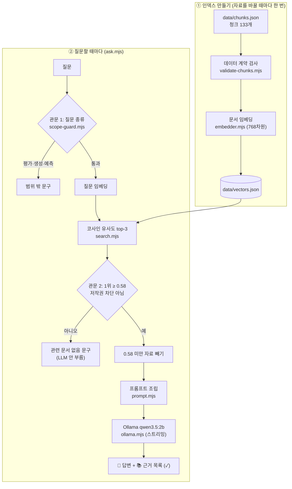

# IP 기획 가이드 챗봇 (로컬 RAG)

IP 기획을 처음 하는 애니메이터가 스토리텔링 이론, 스튜디오 제작 기법, IP 확장 전략, 국내 캐릭터 사례를 물으면 **출처가 확인된 자료만 근거로** 답하는 터미널 챗봇입니다. 검색·생성 모두 내 Mac에서 돌아갑니다(서버·배포 없음).

## 1. 소개

**답하는 것**: 자료(청크 133개)에 적힌 내용. 답변 뒤에 근거로 쓴 자료의 id·출처 url·확인일을 보여 줍니다.

- 스토리텔링 이론: 영웅의 여정, 3막 구조, 세이브 더 캣 비트 시트, 체호프의 총, 아리스토텔레스 『시학』 등
- 스튜디오 제작 기법과 작품: 디즈니 12원칙, 스토리보드, 모델 시트, 픽사 브레인트러스트, 지브리·픽사 작품
- IP 확장 전략: IP(지식재산권)의 뜻, OSMU, 미디어 믹스, 트랜스미디어, 미디어 프랜차이즈, MCU
- 국내 캐릭터 사례: 카카오프렌즈, 라인프렌즈, 최고심, 망그러진 곰, 엄마 까투리, 무직타이거, 조구만 스튜디오

**답하지 않는 것**: 아래 정해진 문장으로만 짧게 답합니다(`src/messages.mjs`).

| 상황 | 답 |
| --- | --- |
| 자료와 관련 없는 질문 (날씨 등) | 질문과 관련된 문서와 출처를 찾지 못해 답변드리기 어렵습니다. |
| 작품 평가·아이디어 생성·성공 예측 | 작품 평가·아이디어 생성·성공 예측은 근거 문서와 출처로 판단할 수 없어 답변드리기 어렵습니다. |
| 저작권 때문에 내용을 넣지 않은 자료 | 저작권 침해 요소가 있어 해당 내용은 제공하지 않습니다. 출처만 안내드립니다. |
| 답 중 자료에 없는 부분 (매출 수치 등) | 이 부분은 관련 문서와 출처를 찾지 못했습니다. |

## 2. RAG 워크플로우



| 단계 | 하는 일 | 파일 |
| --- | --- | --- |
| 1. 자료 검사 | 필수 필드·허용 값·120자 규칙·라이선스 조합을 검사하고, 언론사·URL·발행일이 빠진 기사는 건너뜀 | `src/validate-chunks.mjs` |
| 2. 문서 임베딩 | 청크마다 `title: 섹션 \| text: 본문`을 768차원 벡터로 바꿔 저장. 모델·설정도 함께 기록 | `src/embedder.mjs`, `src/build-index.mjs` |
| 3. 관문 1 (질문 종류) | "성공할까", "평가해 줘", "아이디어 줘" 같은 표현을 정규식으로 찾아 검색 전에 멈춤 | `src/scope-guard.mjs` |
| 4. 질문 임베딩·검색 | 질문을 `task: search result \| query: 질문`으로 임베딩, 내적(=코사인 유사도)으로 top-3. 저장소의 모델·설정이 다르면 검색 거부 | `src/search.mjs` |
| 5. 관문 2 (근거 강도) | 1위 점수가 0.58 미만이거나 1위가 저작권 차단 자료면 LLM을 부르지 않음. 2·3위 중 0.58 미만 자료도 빼고 넘김 | `src/ask.mjs` (`decide`, `usableHits`) |
| 6. 프롬프트 조립 | 시스템 메시지(자료 안에서만 답하기, 없으면 정해진 문구) + ① 자료 소개 ② 근거 원칙 ③ 출처 규칙 ④ 현재 시각 ⑤ 자료 ⑥ 질문 ⑦ 출처 규칙 반복 | `src/prompt.mjs`, `src/messages.mjs` |
| 7. 생성 | Ollama `/api/chat`에 stream·think:false·temperature 0으로 보내고, NDJSON 조각을 받는 대로 출력 | `src/ollama.mjs` |
| 8. 근거 표시 | LLM에 넘긴 자료를 모두 📚 목록으로 보여 주고, 답변에 그 ID가 있으면 ✓. 견본 ID(`MK-000`)를 베끼면 ⚠ | `src/ask.mjs` (`formatSources`) |

근거 목록을 LLM이 아니라 프로그램이 만드는 이유: 2B 모델은 근거 ID를 자주 빼먹습니다(8장). ID가 없어도 어떤 자료를 보고 답했는지 확인할 수 있게 하려는 것입니다.

## 3. 사용 기술

| 영역 | 기술 | 설정과 이유 |
| --- | --- | --- |
| 실행 환경 | Node.js (ES 모듈), 터미널 | 서버·화면 없이 `node src/파일.mjs`로 실행. 의존성은 transformers.js 하나 |
| 임베딩 라이브러리 | transformers.js `@huggingface/transformers` | ONNX 모델을 내 컴퓨터에서 실행 (인터넷은 첫 모델 다운로드 때만) |
| 임베딩 모델 | `onnx-community/embeddinggemma-300m-ONNX` | dtype q8, 768차원, mean pooling + 정규화. 한국어·영어 혼합 자료를 같은 공간에서 비교 |
| 입력 형식 | embeddinggemma 공식 프롬프트 | 문서 `title: 섹션 \| text: 본문`, 질문 `task: search result \| query: 질문` |
| 벡터 저장소 | JSON 파일 하나 (`data/vectors.json`) | 청크 133개라 전체 비교로 충분. 별도 벡터 DB 없음 |
| 검색 | 내적 = 코사인 유사도, top-k (기본 3) | `--category`로 분류 제한 가능 |
| 근거 강도 기준 | `WEAK_THRESHOLD` 0.58 | 평가 질문으로 측정해 정함 (7장) |
| 질문 종류 관문 | 정규식 패턴 | 단어가 아니라 "성공할까" 같은 예측·평가·생성 요청 표현만 잡음. `test-scope.mjs`로 막을 질문 23개·통과할 질문 19개 검사 |
| LLM | Ollama `qwen3.5:2b` | `/api/chat`, stream:true, think:false, temperature 0 (같은 질문엔 같은 답 → 비교 실험 가능) |
| 스트리밍 | NDJSON + `TextDecoder({stream:true})` | 한글이 조각 경계에서 깨지지 않게 하고, 덜 받은 줄은 버퍼에 남겨 다음 조각과 합침 |
| 평가 | Hit@3, 기준 점수 여유, RAG 유무 비교 | `eval-search.mjs`, `compare.mjs` |

## 4. 파일 구조

```
ip-guide-rag/
├─ README.md                  이 문서 (제출물)
├─ PRD.md                     제품 요구사항: 목표·비목표·수용 기준·코퍼스 설계·결정 사항
├─ CLAUDE.md                  설계 계약: 제품·데이터·임베딩·검색·생성 규칙
├─ package.json               의존성 (@huggingface/transformers)
├─ data/
│  ├─ chunks.json             청크 원본 133개 (출처·라이선스·확인일 포함)
│  ├─ vectors.json            임베딩 결과 (모델·설정 + 청크별 768차원 벡터)
│  └─ chunks-review.md        청크 검토표, 변경 기록, 제외한 자료
├─ src/
│  ├─ embedder.mjs            임베딩 모델 정의 (문서·질문 입력 형식)
│  ├─ validate-chunks.mjs     데이터 계약 검사
│  ├─ build-index.mjs         청크 → vectors.json
│  ├─ search.mjs              [1단계] 질문 → top-k 청크
│  ├─ scope-guard.mjs         질문 종류 관문 (평가·생성·예측)
│  ├─ messages.mjs            거절·안내 문구 4개
│  ├─ prompt.mjs              시스템 메시지와 프롬프트 조립
│  ├─ ollama.mjs              Ollama 연결 확인·스트리밍
│  ├─ ask.mjs                 [2단계] 관문 → 검색 → 판정 → 생성 → 근거 목록
│  ├─ eval-search.mjs         평가 질문 검색 → eval/search-results.md
│  ├─ compare.mjs             RAG 유무 비교 → eval/compare-results.md
│  └─ test-scope.mjs          관문 검사 (모델 없이 실행)
└─ eval/
   ├─ questions.json          평가 질문 24개와 정답 청크 id
   ├─ search-results.md       1단계 관찰 결과
   ├─ compare-questions.json  비교 질문 10개
   └─ compare-results.md      RAG 유무 답변 원문
```

## 5. 실행 방법

준비 (처음 한 번):

```bash
ollama pull qwen3.5:2b
npm install
```

인덱스 만들기 (청크를 바꿀 때마다):

```bash
node src/build-index.mjs
```

1단계 검색만 보기:

```bash
node src/search.mjs "영웅의 여정은 어떤 단계야?"
node src/search.mjs "OSMU가 뭐야?" --k 5 --category MK
```

2단계 답변 (Ollama가 켜져 있어야 함):

```bash
node src/ask.mjs "조구만 스튜디오는 어떤 채널에서 먼저 팬을 모았어?"
```

| 옵션 | 뜻 |
| --- | --- |
| `--k 5` | 검색할 자료 개수 (기본 3) |
| `--show-prompt` | LLM을 부르지 않고 조립된 시스템 메시지·프롬프트만 출력 (Ollama 없이 동작) |
| `--no-rag` | 검색·규칙 없이 질문만 LLM에 보냄 (비교 실험용) |

검사·평가·실험:

```bash
node src/validate-chunks.mjs   # 청크 데이터 계약 검사
node src/test-scope.mjs        # 질문 종류 관문 검사 (모델 없이)
node src/eval-search.mjs       # 평가 질문 24개 검색 → eval/search-results.md
node src/compare.mjs           # RAG 없이/RAG 비교 10문항 → eval/compare-results.md
node src/compare.mjs --only B  # 일부만 다시 돌리기 → eval/compare-results-only-B.md (전체 결과는 그대로)
```

## 6. 자료

청크 133개 (`data/chunks.json`). 전체 목록(id·섹션·출처 url)과 변경 기록은 `data/chunks-review.md`에 있습니다.

| 분류 | 개수 | 담은 내용 |
| --- | --- | --- |
| TH 스토리텔링 이론 | 26 | 플롯·서사 구조, 영웅의 여정, 세이브 더 캣, 『시학』 |
| ST 스튜디오 기법 | 7 | 애니메이션 12원칙, 스토리보드, 모델 시트, 브레인트러스트 |
| WK 스튜디오 작품 | 54 | 지브리 23편, 픽사 31편 |
| MK IP 확장 전략 | 17 | IP 정의, OSMU, 미디어 믹스, 트랜스미디어, 프랜차이즈, MCU, 지브리·픽사 |
| CS 국내 캐릭터 사례 | 29 | 카카오프렌즈, 라인프렌즈, 최고심, 망그러진 곰, 엄마 까투리, 무직타이거, 조구만 |

**출처와 라이선스**

| 자료 | 청크에 넣은 방식 | 라이선스·권리 |
| --- | --- | --- |
| 한국어·영어 위키백과 (TH·ST·WK·MK·CS 일부) | 문서를 한국어로 요약·번역, 청크마다 문서 url 표기 | [CC BY-SA 4.0](https://creativecommons.org/licenses/by-sa/4.0/). 이 청크들(과 그 벡터)은 같은 조건으로 재사용할 수 있습니다 |
| 『The Poetics of Aristotle』 S. H. Butcher 영역 (TH-014~016) | 프로젝트 구텐베르크 원문을 한국어로 번역·요약 | 퍼블릭 도메인 |
| KCI 논문 초록 4편 (CS-011~017) | 원문 문장 없이 초록에 적힌 사실만 정리, KCI url 표기 | 원문 저작권은 저자·학회에 있음. 원문은 링크로 확인 |
| 언론 기사 9건 (CS-021~026, CS-031~038) | 원문 문장 없이 기사에 적힌 사실만 정리, 언론사·발행일·url 표기 | 원문 저작권은 각 언론사에 있음. 원문은 링크로 확인 |

책·논문·기사 원문, 캐릭터 이미지, 참고 자료 원문은 저장소에 넣지 않았습니다. 캐릭터·작품·회사 이름은 해당 권리자의 상표이며, 이 프로젝트는 학습용으로 사실을 인용할 뿐 권리자와 관계가 없습니다.

**청크 설계 원칙**

1. **출처에 적힌 사실만**: 한 청크에 주장 하나, 120자 이상. 개인 생각이나 AI의 추측·해석은 넣지 않고, 검토 메모는 본문이 아닌 `review_note`에 둡니다.
2. **원문은 허용된 것만**: 위키백과(CC BY-SA)와 퍼블릭 도메인만 원문을 옮기고, 논문 초록과 기사는 적힌 사실만 정리해 링크를 줍니다. 출처나 발행일이 없는 기사, 출처 없는 PDF·생성 요약은 넣지 않습니다.
3. **중복 없이**: 목록(12원칙, 17단계, 비트 시트)은 한 청크에 담고, 같은 사실은 한 청크에만 둡니다. 폐기한 id는 다시 쓰지 않습니다.

## 7. 1단계 관찰 기록 (STEP 5, 청크 133개 기준)

평가 질문 24개(`eval/questions.json`)를 `node src/eval-search.mjs`로 검색한 결과입니다. 원본: `eval/search-results.md`.

| # | 분류 | 유형 | 질문 | 1위 | 점수 | 2위 | 3위 | 정답 포함 / 판정 |
| --- | --- | --- | --- | --- | --- | --- | --- | --- |
| 1 | ST | 정상 | 캐릭터가 여러 장면에서 똑같이 보이게 하려면? | ST-107 | 0.627 | CS-038 (0.622) | CS-011 (0.586) | ✅ |
| 2 | ST | 다른 표현 | 애니메이션에서 동작 직전에 반대 방향으로 살짝 움직이는 원칙은? | ST-102 | 0.686 | ST-101 (0.567) | ST-107 (0.564) | ✅ |
| 3 | ST | 정상 | 콘티는 기획이랑 뭐가 달라? | ST-105 | 0.640 | TH-001 (0.547) | TH-003 (0.514) | ✅ |
| 4 | ST | 다른 표현 | 픽사 감독들이 서로 작품에 솔직한 피드백을 주는 회의는? | ST-112 | 0.737 | WK-206 (0.604) | WK-225 (0.601) | ✅ |
| 5 | MK | 정상 | OSMU가 뭐야? | MK-001 | 0.685 | MK-002 (0.656) | MK-005 (0.598) | ✅ |
| 6 | MK | 정상 | 트랜스미디어 스토리텔링은 OSMU랑 어떻게 달라? | MK-005 | 0.771 | MK-002 (0.630) | MK-001 (0.619) | ✅ |
| 7 | MK | 정상 | MCU는 여러 작품을 어떻게 하나의 세계로 묶었어? | MK-011 | 0.756 | CS-038 (0.587) | MK-009 (0.581) | ✅ |
| 8 | MK | 정상 | 디즈니는 언제 픽사를 인수했어? | MK-013 | 0.776 | MK-014 (0.704) | WK-204 (0.613) | ✅ |
| 9 | CS | 정상 | 카카오프렌즈는 어디서 시작했어? | CS-001 | 0.690 | CS-003 (0.660) | CS-002 (0.630) | ✅ |
| 10 | CS | 다른 표현 | 라인 스티커가 어떻게 캐릭터가 됐어? | CS-006 | 0.759 | CS-005 (0.668) | CS-007 (0.590) | ✅ |
| 11 | CS | 정상 | 최고심은 인스타그램에서 어떤 전략을 썼어? | CS-011 | 0.722 | CS-012 (0.682) | CS-014 (0.540) | ✅ |
| 12 | CS | 정상 | 망그러진 곰과 두산베어스 협업 효과는? | CS-013 | 0.788 | CS-014 (0.731) | CS-024 (0.592) | ✅ |
| 13 | TH | 정상 | 영웅의 여정은 어떤 단계로 나뉘어? | TH-102 | 0.753 | TH-113 (0.750) | TH-101 (0.723) | ✅ |
| 14 | TH | 정상 | 시나리오 작법서 『세이브 더 캣』의 이야기 설계표(비트 시트)에서, 영화 한가운데 오는 '미드포인트'는 어떤 장면이야? | TH-123 | 0.728 | TH-126 (0.713) | TH-121 (0.688) | ✅ |
| 15 | TH | 다른 표현 | 초반에 나온 소품은 나중에 꼭 쓰여야 한다는 원칙은? | TH-012 | 0.711 | TH-126 (0.642) | ST-102 (0.632) | ✅ |
| 16 | TH | 정상 | 아리스토텔레스는 비극을 어떻게 정의했어? | TH-014 | 0.764 | TH-015 (0.701) | TH-009 (0.691) | ✅ |
| 17 | OUT | 무관 | 내일 날씨 알려 줘 | WK-222 | 0.436 ⚠ | WK-117 (0.431) | WK-230 (0.428) | — |
| 18 | OUT | 무관 | 김치찌개 레시피 알려줘 | CS-012 | 0.455 ⚠ | TH-011 (0.446) | CS-015 (0.434) | — |
| 19 | OUT | 도메인 밖 | 내 캐릭터 아이디어가 성공할까? | CS-011 | 0.622 | CS-006 (0.615) | CS-012 (0.615) | ⛔ 범위 차단 |
| 20 | OUT | 주제 안·답 없음 | 무직타이거 작년 매출은 얼마야? | CS-021 | 0.654 | CS-022 (0.626) | CS-023 (0.621) | LLM 규칙이 처리 (STEP 8 F) |
| 21 | MK | 정상 | IP가 뭐야? | MK-015 | 0.649 | MK-017 (0.641) | CS-005 (0.554) | ✅ |
| 22 | MK | 다른 표현 | IP에 대해 알려줘 | MK-015 | 0.651 | MK-017 (0.649) | CS-005 (0.556) | ✅ |
| 23 | CS | 정상 | 무직타이거는 어떤 방식으로 성장했어? | CS-021 | 0.620 | CS-025 (0.587) | CS-022 (0.587) | ✅ |
| 24 | CS | 정상 | 조구만 스튜디오는 어떤 채널에서 먼저 팬을 모았어? | CS-032 | 0.724 | CS-031 (0.716) | CS-038 (0.643) | ✅ |

**요약**

- Hit@3 20/20: 자료 안 질문은 모두 정답 청크가 top-3에 들었다.
- 자료 안 질문의 1위 최저점 0.620(23번), 점수로 걸러야 할 자료 밖 질문(17·18번)의 최고점 0.455. 기준 0.58은 그 사이에 있다(자료 안 쪽 여유 0.040, 자료 밖 쪽 여유 0.125).
- 기준 0.58은 처음(청크 119개) 측정에서 양쪽 여유가 같은 값으로 정했다. 자료가 늘면서 자료 안 쪽 여유가 줄었으므로, 자료를 더 넣으면 다시 재야 한다.
- 19·20번은 점수로 거를 수 없어 기준 계산에서 뺐다(아래 3번).

**생각해 볼 것**

1. **단어가 겹치지 않아도 찾는 이유**: 임베딩은 단어가 아니라 뜻을 비교한다. 2번 "동작 직전에 반대 방향으로 살짝 움직이는 원칙"에는 "예비 동작"이라는 말이 없지만 12원칙 청크(ST-102)가 0.686으로 1위였다. 15번도 "체호프의 총"이라는 말 없이 TH-012를 찾았다.
2. **자료 밖 질문도 1위는 항상 나온다**: "내일 날씨"(0.436), "김치찌개 레시피"(0.455)도 1위 청크가 있다. 검색은 가장 가까운 것을 고를 뿐 답이 있는지는 모른다. 그래서 기준 점수 미만이면 LLM에 넘기지 않는다.
3. **점수만으로 막을 수 없는 질문이 있다**: 점수는 "무엇에 관한 질문인가"만 본다. 19번 "내 캐릭터 아이디어가 성공할까?"(0.622)는 주제가 같아 기준을 넘으므로 검색 전 질문 종류 관문이 막는다. 20번 "무직타이거 작년 매출은?"(0.654)은 기사는 있지만 매출 수치가 없어, LLM이 "이 부분은 관련 문서와 출처를 찾지 못했습니다."로 답하게 했다(8장 F).
4. **비슷한 청크가 함께 올라온다**: 13번에서 캠벨 17단계(TH-102, 0.753)와 보글러 12단계(TH-113, 0.750)가 거의 같은 점수였다. 출처가 다른 두 모델이라 근거 ID로 구분해야 한다. 4번에서는 관련 없는 픽사 작품 청크(WK-206, WK-225)가 "픽사"라는 단어에 끌려 올라왔다.
5. **자료가 없으면 검색도 못 찾는다**: "IP가 뭔지 알려줘"는 처음에 기준 미만으로 멈췄다. IP를 정의한 청크가 없었기 때문이다. 위키백과 「지식 재산권」·「Intellectual property」에서 MK-015~017을 넣자 통과했고, 표현을 바꾼 21·22번으로 다시 깨지지 않는지 본다.

## 8. 2단계 기록 (STEP 7~8)

**첫 실행 (STEP 7)**: Mac(Apple Silicon)에서 답변이 1~4초 만에 글자 단위로 흘러나왔다(참고 예시의 CPU 전용 약 40초보다 빠름). Ollama가 꺼져 있거나 모델이 없으면 확인 명령을 안내하고 멈춘다. 2B 모델은 근거 ID를 문장 끝이 아니라 답변 맨 끝에 몰아 적는 경향이 있었다. 질문별 결과는 아래 비교표에 합쳤다.

**RAG 유무 비교 (STEP 8)**: `node src/compare.mjs`로 같은 질문을 RAG 없이(`--no-rag`)와 RAG로 물었다(청크 133개, 기준 0.58). 답변 원문은 `eval/compare-results.md`. "지어낸·틀린 문장"은 답변을 청크 원문(RAG)이나 출처(RAG 없이)와 대조해 직접 센 수다.

> ⚠ "RAG 없이" 열은 LLM이 자료 없이 지어낸 **틀린 답의 요약**입니다. 실제 기업·작품에 대한 사실이 아닙니다.


**요약**

- 지어낸·틀린 문장: RAG 없이 22개 이상(J는 질문 자체를 오해) → RAG 2개(B 날짜, J 주어 섞임) → 검수 후 1개(J). 자료가 없을 때(F·H·I)는 지어내지 않고 정해진 문구로 멈췄다.
- RAG 없이 답하면 고유명사를 엉뚱한 뜻으로 해석한다: IP→인터넷 프로토콜, 카카오프렌즈→카카오톡, 무직타이거→실업 현상, 조구만→K-POP 그룹. 자료가 질문의 뜻부터 잡아 준다.
- 근거 ID는 RAG 답변 8개 중 4개에만 있었다(PRD 목표 90%에 못 미침). 📚 근거 목록을 프로그램이 따로 보여 주는 설계가 그래서 필요했다.

**검수 후 고친 것**

- **예시 문구 베끼기 (B)**: 시스템 메시지의 예시 "'위키백과는 …라고 적는다'"를 답변에 그대로 적었다. 예시를 빼고 "자료 문장에 출처를 밝힌 표현이 있으면 빼지 않습니다"로 바꾸자 사라졌다.
- **숫자 오독 (B)**: 청크의 "2006년 1월 74억 달러에 … 합의"를 "1월 7일"로 읽었고, 프롬프트를 고쳐도 같았다(temperature 0). 사실은 그대로 두고 "2006년 1월 … 합의했다(인수 금액 74억 달러)"로 순서만 바꾸자 원문대로 답했다. 작은 모델을 쓸 때는 청크에서 날짜와 금액을 떼어 쓰는 것도 데이터 설계의 일부다.

## 9. 한계와 다음 단계

**한계**

- **2B 모델**: 근거 ID를 절반 정도만 달고, 자료 문장을 거의 그대로 옮기며(C·D·E), 여러 자료를 합칠 때 주어를 섞는다(J). 답을 믿기 전에 📚 근거 원문과 대조해야 한다.
- **질문 종류 관문**: 정규식 목록에 없는 말투는 놓칠 수 있다. 빠져나간 질문은 시스템 메시지가 한 번 더 막지만 2B 모델이 늘 지키지는 않는다.
- **top-3**: "카카오프렌즈가 성공한 과정"처럼 여러 청크에 걸친 질문은 일부만 답한다(C).
- **자료 범위**: 위키백과 기술 시점과 기사 발행일 기준의 사실이다. 스티키몬스터랩 자료와 《2025 캐릭터산업백서》는 아직 없다.

**다음에 해 볼 것**

- 시스템 메시지를 줄여 근거 ID 표기율이 오르는지 (한 번에 한 가지만 바꿔 비교)
- `--k 5`, 같은 출처 청크 묶기로 여러 청크에 걸친 질문의 답 범위 넓히기
- 고유명사 질문에 BM25를 섞은 하이브리드 검색 (PRD 선택 심화)
- 스티키몬스터랩 기사 수집, 기사 청크의 발행일 기준 갱신
